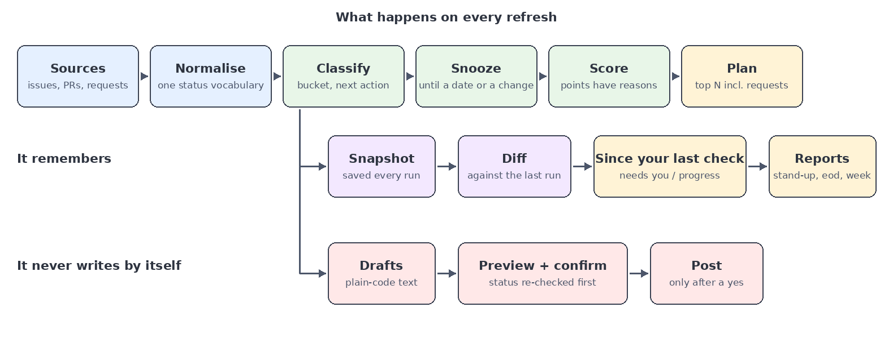

# work-progress-briefing

Where your work stands **right now**, whenever you ask: a ranked plan, what changed since you last looked, things you can
snooze until they matter again, comments you approve before anything is posted, and stand-up / end-of-day / weekly
reports. It reads your GitHub issues and pull requests through the [`gh`](https://cli.github.com) CLI. No dependencies
beyond Python 3.10+.

It started as a "morning briefing" and stopped being one the moment it could be run at 2 pm and say *what changed since
the last time*. That one idea, a tool that remembers its previous run, drives most of the design (see
[How it works](#how-it-works)).

> All example data in this repository is fictional (an invented organisation called `acme-labs`).

## Try it in two minutes, no account needed

```bash
git clone https://github.com/tjaensch/work-progress-briefing && cd work-progress-briefing
python3 -m work_briefing demo
```

The demo replays a small invented story over four "days" through the real GitHub adapter (only the `gh` command is
faked) and prints the last briefing, then a stand-up and a weekly report built from the same history:

```
## Today's plan
1. **acme-labs/widget-api#12** Rate limiter drops valid requests
   Next: Approved: merge
   Why: bucket: ready (+20); due in 2d (+20); quick win (+12)
2. **acme-labs/widget-api#30** Clearer webhook signature error
   Next: Respond to new comments, then continue
   Why: bucket: ready (+20); unanswered comments from others (0d) (+15); already in progress (+5)
3. **acme-labs/widget-api#15** Add pagination to /v2/orders
   Next: Fix failing CI on PR
...
## Since your last check (18h ago)
- **needs you:** acme-labs/widget-api#12: PR widget-api#40 review changes_requested -> approved
- **needs you:** acme-labs/widget-api#30 has 1 new comment(s), latest by kim-docs
- **needs you:** acme-labs/widget-api#15: PR widget-api#44 CI started failing
- acme-labs/widget-api#21: PR widget-api#38 OPEN -> MERGED
...
## Drafts for your approval (nothing is posted until you confirm)
- `acme-labs/widget-api#21:status_update` Update status of acme-labs/widget-api#21: PR merged but item is still in progress
  > Status update: PR https://github.com/acme-labs/widget-api/pull/38 has been merged. This is still marked in progress; ...
  - Apply: `work-briefing apply acme-labs/widget-api#21:status_update`
```

The demo keeps its files in `<home>/demo` and every command pointed at that folder (`snooze`, `apply`, `report`, a refresh)
keeps using the demo data. It never reaches GitHub.

## Use it on your own work

```bash
gh auth login                       # once
python3 -m work_briefing            # refresh and print a summary, from the cloned folder
pipx install .                      # optional: a `work-briefing` command you can run from anywhere
work-briefing run --full            # the whole briefing as markdown
```

It collects:

- open **issues assigned to you**, with the pull requests that close them;
- your **open pull requests** that no assigned issue covers;
- **review requests** waiting on you.

Files go to `$WPB_HOME` (default `~/.local/share/work-progress-briefing`): `out/latest.md`, `out/latest.json`, dated copies,
`out/drafts-*.json`, and `state/` (snapshots, an event log, snoozes). Run it from cron, a task runner or by hand; commands
that write state take a lock, so overlapping runs wait for each other instead of corrupting anything.

### Commands

| Command | What it does |
|---|---|
| `work-briefing [run]` | Refresh and print a summary (`--full` for markdown, `--no-snooze` to see everything, `--since-last` to diff against the last run instead of the last day). |
| `report standup\|eod\|week` | Reports from the event log and the latest briefing. No network, instant, deterministic. |
| `snooze ID [--days N \| --until DATE \| --until-change]`, `dismiss ID`, `unsnooze ID`, `snoozes` | Hide things until a date or until they change. |
| `apply DRAFT_ID [--yes]` | Post a draft after showing it and asking. |
| `demo` | The fictional walkthrough above. |

Snooze ids: an item (`owner/repo#12`) hides the whole item; `owner/repo#12:mismatch` only its status-mismatch warning;
`owner/repo#12:nudge` one draft; `in-xxxxxxxx` one incoming request (the id is in the JSON). `snooze` lists valid ids when
you give it a wrong one.

### Configuration

Optional `config.json` in the home folder; an unknown key is an error, so a typo is never ignored:

```json
{
  "repos": ["acme-labs/widget-api"],
  "plan_size": 5,
  "stale_days": 7,
  "nudge_after_days": 3,
  "mismatch_transitions": { "open_todo": "in_progress" }
}
```

## Use it from your editor (optional)

It's meant to live where you already work. [`examples/vscode/tasks.json`](examples/vscode/tasks.json) has two VS Code tasks: one
runs the briefing and opens `latest.md` in a tab whenever you open the folder (VS Code asks once to allow automatic tasks), the
other is "refresh now" from the command palette (Tasks: Run Task). Copy it to `.vscode/tasks.json`. The tasks run the `work-briefing` command, so install it first (`pipx install .` in the cloned folder). If a refresh fails, the
failure banner appears at the top of that same tab.

## Use it from an AI agent (optional)

The tool has no model inside it, but it is built to be driven by one. (The skill runs the `work-briefing` command, so install it first with `pipx install .`.) [`examples/copilot-skill/SKILL.md`](examples/copilot-skill/SKILL.md)
is a skill for GitHub Copilot in VS Code: copy it (a copy, not a symlink, since symlinked skills are not always discovered)
to `.github/skills/work-progress-briefing/SKILL.md` in your workspace, reload the window, and type
`/work-progress-briefing` in chat. The agent refreshes the briefing, summarises `latest.json`, answers follow-up questions
("why is that one first?"), snoozes things on request, and shows you each draft word for word. It posts only after you say
yes, by running `work-briefing apply <id> --yes`, and `apply` still refuses if the item changed in the meantime.

What makes the tool easy for an agent to use: all facts are in one JSON file with stable ids, every action is a plain
command with clear exit codes, a failed refresh says so instead of leaving stale data to be summarised, and the only
command that writes is the one that asks first.

## How it works



```
sources ──► normalise ──► classify ──► snooze ──► score ──► plan
(gh)        (Item)        (bucket,      (hide,     (why a    (top N,
                           mismatch)     quiet)     number)   incl. requests)
                                │
        snapshot ──► diff vs last run ──► "since your last check", event log ──► reports
                                │
                              drafts ──► preview ──► you confirm ──► post
```

- **One status vocabulary.** A source maps its own states onto `todo`, `in_progress`, `in_review`, `blocked`, `done`
  (`github_source.derive_status`). Everything after that is source-agnostic.
- **Rules, not a model.** Buckets (ready, start, waiting, blocked, stale, backlog), next actions, status mismatches and the
  score are plain functions you can read and test. Every score lists its parts ("due in 2d (+20)"), so a ranking is never a
  mystery.
- **It remembers.** Each refresh saves a snapshot. Diffing two snapshots gives typed changes, each tagged *progress* (a PR
  merged, a status moved forward) and/or *needs attention* (someone commented, CI started failing). The same log feeds
  "progress today" and the reports.
- **Snooze means "until it matters."** A snooze can end on a date, when a fingerprint of the item changes (new comment from
  someone else, status or PR change), or whichever comes first. Your own comments don't count as a change, so posting a
  nudge doesn't un-snooze it.
- **Drafts, never writes.** Building a draft posts nothing. `apply` re-checks the item's current status, shows the exact
  text, says whether a status change is actually available, and asks. If the status changed since the draft was made, it
  refuses. Comment text for mismatches is fixed wording, so it's predictable.
- **A mismatch draft appears only while the news is fresh.** "PR merged but the item is still *in progress*" produces a
  draft only if nothing has touched the item since the merge. Posting the comment touches it, so the draft doesn't come
  back.
- **Failure is visible.** A failed refresh writes `out/status.json` and puts a banner at the top of `latest.md`, so an open
  editor tab can't quietly show stale data. Exit code 2 means retrying won't help (not logged in, `gh` missing).
- **Writes are atomic and locked.** Briefing files are replaced via a temp file; state-changing commands share an `flock`
  lock that disappears with its process.

### Add another source

A source returns `Item`s (see `work_briefing/models.py`) and, if you want drafts to be postable, implements the four-method
`Tracker` protocol in `work_briefing/actions.py`:

```python
class Tracker(Protocol):
    def get_status(self, item_id: str) -> str: ...
    def available_transitions(self, item_id: str) -> list[str]: ...
    def comment(self, item_id: str, text: str) -> None: ...
    def transition(self, item_id: str, to_status: str) -> bool: ...
```

`work_briefing/github_source.py` is the reference implementation; the command runner is injected, which is also how the demo
and the tests run against fake data.

## Safety

- It only reads, except through `apply`, which asks every time (`--yes` exists for scripts and chat tools that have already
  asked you).
- Commands are run without a shell, with arguments as a list. Comment text is passed as a single argument.
- `work_briefing/util.redact` removes common secret shapes; use it on anything you send to a model if you add one.
- No telemetry, no network access except through `gh`.

## Development

```bash
python3 -m pip install pytest
python3 -m pytest                 # ~230 tests, all on fictional data
python3 scripts/check_scrub.py    # leak guard, see below
git config core.hooksPath .githooks
```

`scripts/check_scrub.py` is a small guard used on this repository's own history: it scans files, file names, commit
messages, authors and every patch for patterns that must never be published (home-directory paths, ticket-style keys that
aren't the fictional `DEMO-n`, account ids, non-example email addresses), plus a private list of terms kept outside the
repository. CI runs only the generic patterns.

## How it was built

Written with GitHub Copilot in VS Code, in agent mode with Claude Sonnet 5.5 as the model, working through a written plan one
small item at a time. Each change got tests, a deliberate-breakage check, a live run and a CI pass before it was committed.

## Status

Version 0.1. GitHub is the only built-in source. Not built: a long-running scheduler (use cron or your editor's task
runner), a language-model summary pass, and calendar or email sources.

## License

MIT
