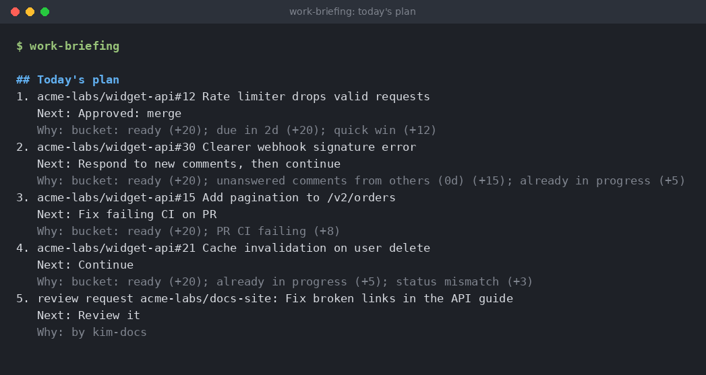
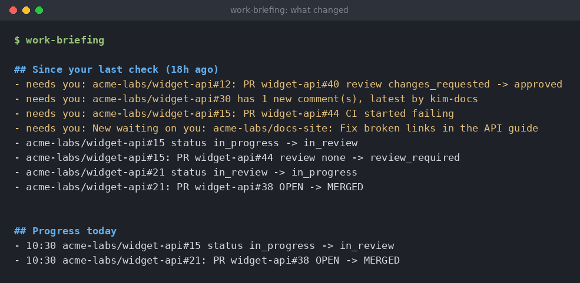
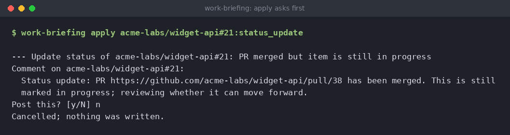
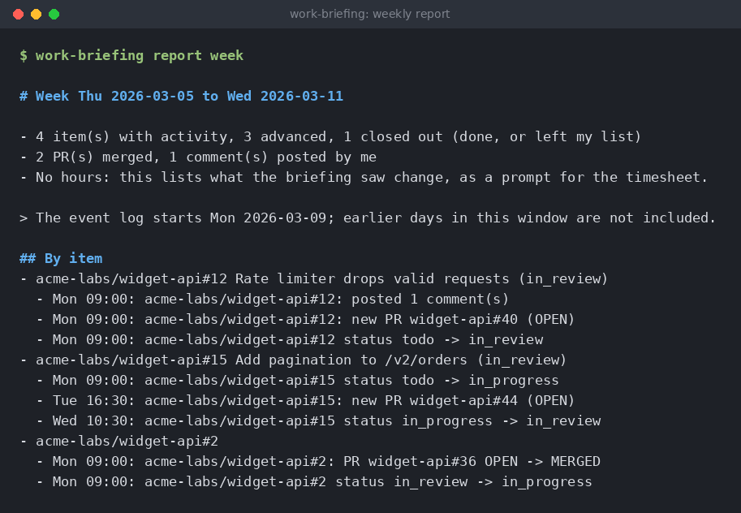

# Building a work briefing that remembers, with GitHub Copilot in VS Code

> I usually have a long list of Jira tickets in my queue, and at any moment they're in different states: some in review, some blocked, a few quietly ready to pick up again. I couldn't tell which was which without clicking through every ticket and pull request. So I built a small open-source Python tool that checks all of it, remembers what it saw last time, and tells me what's ready, what's stuck and what moved while I was in a meeting. I wrote it with Copilot's agent mode in VS Code, and an agent drives it too: it runs the tool, reads the result and drafts the comments, but nothing gets posted without my yes.


Who does what. The tool does the bookkeeping, the agent does the talking, and nothing gets posted without my yes.

The need came up in my day-to-day work. I have a long list of Jira tickets assigned to me, with GitHub pull requests and reviews attached to a lot of them, and at any given moment they're in all kinds of states: in review, blocked, ready to pick up again. What I wanted was simple: every morning, go through everything that has been updated, tell me which tickets are ready for me to continue, and also point out the ones I haven't touched yet that might be ready to start.

Claude Desktop was the first thing I thought of, but at the time it couldn't connect to most of the places my work lives. Copilot in VS Code could already reach Jira and GitHub, so I started there and had it build the first version as a script.

It worked, and then something funny happened. I ran it in the afternoon, just to see, and it told me what had changed since the last time I ran it. That was so much more useful than the morning report that it stopped being a morning briefing and became a "where do I stand right now" tool.

I built it to live in my editor, because that's where I spend most of my day. A VS Code task opens the briefing in a tab when I open the project, a failure shows up as a banner in that same tab, and the chat skill lets me ask about it without leaving the window. The briefing should come to where I already am, instead of being one more tab I have to remember to check. My own version pulls Jira, GitHub, mail and my calendar into that one place. The one I'm sharing here sticks to GitHub issues and pull requests, because that's something anybody can try, and it comes with a demo that uses made-up data so you don't need an account to see it.

## What it does

You run it and it reads your open issues, your open pull requests and the review requests waiting on you. It uses the GitHub command line tool for that, so the script itself never touches a token. Then it gives you:

* a ranked plan for the rest of the day, with the reason for every point in the ranking
* a list of what changed since you last looked
* drafts of comments you might want to post, which it never posts on its own
* stand-up, end-of-day and weekly reports

This is the plan from the demo, a made-up team in a made-up organization:



The demo's plan for a Wednesday morning. Every name in it is invented.

The "Why" lines are my favorite part. Every point in a score has a name, so when the ranking surprises me I can see which rule did it and change the rule, instead of arguing with a number.

## Remembering the last run

This is the idea that made the tool useful. Every time it runs, it saves a small snapshot of what it saw: the status of each item, who commented, the state of its pull requests, whether the checks are failing. The next run compares the new snapshot with the old one.

Each difference gets two labels: did something move forward, and does it need me? That's all it takes to build a "since your last check" list.


Three runs in one day. Each one only tells me what's new.



The same briefing, the part that compares it with the run 18 hours earlier.

## Snoozing until something happens

Most snooze buttons are timers. What I actually mean when I snooze something is "ignore this until something happens", so a snooze in this tool can end on a date, or when the item changes, whichever comes first. "Changes" means a new comment from someone else, the status moving, or a pull request changing state, review or checks.

```
$ work-briefing snooze acme-labs/widget-api#5 --days 3 --reason parked
Snoozed acme-labs/widget-api#5 until Sat 2026-03-14
```

My own comments don't count as a change. Otherwise posting a nudge on a snoozed item would wake it up right away, which is the opposite of what I wanted.

## It never posts anything on its own

The tool builds comments and status changes I might want to make, but it doesn't post them. To post one I run a separate command, which looks up the item's current status again, shows me the exact text, tells me whether the status change is even possible right now, and asks.



Saying no is always an option.

If the item's status changed after the draft was made, it refuses and asks me to run the briefing again, since the wording was written for a situation that doesn't exist anymore. And if the status change isn't available, it posts the comment only and tells me so.

The text of these drafts is fixed wording, not AI output. Something like "PR … has been merged. This is still marked in progress; reviewing whether it can move forward." Boring on purpose, and the same every time.

There's also a rule about when such a draft shows up. It only appears while nothing has touched the item since the merge, because posting the comment touches the item and the draft goes away by itself.

## When it breaks, I want to know

A briefing you trust is dangerous when it's quietly out of date. So when a refresh fails, the tool writes a small status file and puts a banner at the top of the briefing, which is useful because I usually have that file open in an editor tab. It also tells apart errors that retrying can fix from ones it can't, like not being logged in.

Files are written under a temporary name and then renamed, and a refresh or a snooze change takes a lock, so two runs can't trample each other.

## Agentic AI, twice

"Agentic AI" gets thrown around a lot, so here's what it means in this project. It shows up in two places, and they're quite different.

The first is how I built the tool. I used Copilot in agent mode with Claude Sonnet 5.5 as the model, and it wrote all of the code and tests. In agent mode Copilot doesn't just suggest the next line of code. I describe what I want and it plans the steps, edits several files, runs the tests, reads the failures and tries again, until I stop it. I didn't compare other models, so I can't tell you how much of this is down to that one. My job turned into reviewing and steering: picking the next item on the plan, and deciding what "done" means for it.

The second is how I use the tool. The repo has a short skill file for Copilot chat. I type /work-progress-briefing and the agent runs the briefing, reads the JSON file it writes, and gives me a short summary of what changed, the plan for the rest of the day and what's waiting on me. Then I can ask follow-ups like "why is that one first?" or "snooze that until Friday" and it runs the right command. For drafts, it shows me the exact text and waits for a yes before it runs the one command that posts.

None of that works unless the tool is easy for an agent to drive. What helped:

* everything the tool knows is in one JSON file with stable ids, so the agent reads facts instead of guessing
* every action is one plain command with clear exit codes, and a failed refresh says so instead of leaving the agent to summarize stale data
* the only command that writes anywhere asks first, and the flag that skips the question is meant for one situation: I already said yes in chat
* I don't rely on the agent's judgment about what's safe, because the tool itself refuses when the status changed after the draft was made

I like that split. The agent is good at reading, explaining and talking to me. Plain code is good at being exactly right.

## Where the AI isn't

The buckets, the next actions and the score are ordinary functions that are instant, easy to test and easy to explain, and the tool itself doesn't call a language model at all. In my own setup I do use one for a narrow job, a short summary of where I left off on an item with a long comment thread, with tools turned off, secrets scrubbed from the input and the answers cached. My rule of thumb: if the output has to be the same every time, or a wrong answer could end up posted somewhere, it doesn't belong to a model.

## Reports

Since the tool already keeps a log of what it saw change, a stand-up, an end-of-day check and a weekly summary are just views of that log. They run offline and give the same text for the same input.



The weekly report from the demo.

"No hours" is a promise that the report only lists what the tool saw change, never how long anything took, and the note about the log starting on Monday admits that the first week is incomplete.

## How I built it with Copilot

As I said, [Copilot's agent mode](https://code.visualstudio.com/docs/copilot/overview) wrote all of the code. What makes me trust code I didn't type myself is a routine I make it follow for every change, even tiny ones:

* write down the change first, in a plan with small items, and what "done" means for each
* write tests next to it, with made-up data only
* break it on purpose: copy the project somewhere else, make one deliberate mistake (flip a comparison, delete a check) and run the tests; if they still pass, they weren't testing that line
* run it for real once, read-only
* docs, commit, and let CI have a look

The breaking-on-purpose step is the one I'd keep if I could only keep one. A green test run only tells you the tests pass, not that they would ever fail.

## Try it

```
git clone https://github.com/tjaensch/work-progress-briefing
cd work-progress-briefing
python3 -m work_briefing demo
```

The demo replays four made-up days through the real GitHub code, with only the `gh` command faked, and prints the final briefing plus a stand-up and a weekly report. Commands pointed at the demo folder never touch GitHub, including the one that posts.

To use it on your own work you need Python 3.10 or newer and the [GitHub CLI](https://cli.github.com). Run `gh auth login` once, then `python3 -m work_briefing` from the cloned folder. If you'd like a `work-briefing` command you can run from anywhere, install it with `pipx install .`. The editor task and the chat skill below both use that command. To have it open in your editor when you open a project, copy `examples/vscode/tasks.json` to `.vscode/`. If you want to drive it from Copilot chat, copy `examples/copilot-skill/SKILL.md` to `.github/skills/work-progress-briefing/` in your workspace.

## Why this is a stub, and how to make it useful for real work

The version I use at work is about twice the size of this one, and it's tied to how my work is set up. It reads Jira, mail and my calendar. It knows what my team's statuses mean, who to tag when I nudge somebody, and which of my tickets belong together. I can't share that, and honestly it wouldn't help you if I could, because all the useful parts are the specifics.

So what you get here is the skeleton without the specifics: remembering the last run, ranking with reasons, snoozing, drafts with a confirmation step, reports, a loud failure signal and an agent skill. What's missing is your work. Here's how I'd turn it into something useful:

* Start from where your work lives. Write an adapter for it that returns items with the shared statuses. The GitHub one is the template, and it's a good job for Copilot too: point it at `github_source.py` and ask for the same thing for your tracker.
* Map your workflow onto the statuses (todo, in progress, in review, blocked, done), and change the rules so "ready to continue" means what it means for you. Mine mostly came from asking what I keep checking by hand.
* Add whatever you lose time to. For me that was mail and calendar. For you it might be an incident channel or a deploy dashboard.
* Write the drafts your team would actually send, and who should get tagged, in fixed wording.
* Put your own rules into the agent skill: what it may do on its own, and what always needs a yes.
* Make it run without you thinking about it, from a scheduler or an editor task.

If you build your own, start with the memory. It's the feature that made the tool useful at any hour of the day, and everything else got easier once it was there.

It's a small tool, around 2,300 lines of Python and about 240 tests, and the public version has no dependencies beyond the standard library. It probably won't fit anyone else's work as it is. But a few plain ideas (remember the last run, explain every number, ask before writing, fail loudly) turned out to matter more to me than the AI part, and I thought they might be useful to somebody else too.

Code is on [GitHub](https://github.com/tjaensch/work-progress-briefing) under the MIT license. Everything in the demo is made up.
